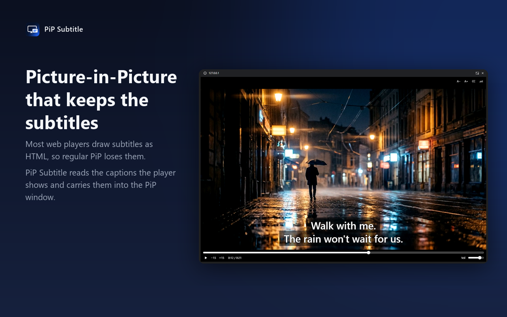

# PiP Subtitle

A Chrome extension that opens a video in Picture-in-Picture **with its subtitles**.



Most web video players (Shaka Player, JW Player, Video.js, Plyr and many others) draw subtitles as
HTML on top of the `<video>` element instead of using the browser's native text tracks. Chrome's
built-in Picture-in-Picture only shows the `<video>` itself, so the subtitles are lost the moment
the video pops out. PiP Subtitle reads the captions the player is currently showing and puts them
into the PiP window.

*Ringkasan bahasa Indonesia ada di bagian bawah.*

## Features

- **Subtitles in PiP** from the player's own caption layer, from the video's text tracks, or from a
  local `.srt` / `.vtt` file.
- **Two display modes**
  - **Clean** (default): a plain PiP window without a title bar; the subtitles are drawn onto the
    video. Time and progress appear while paused or right after a seek.
  - **Full**: a PiP window with a mini player (seek bar, ±15 s, play/pause, type a time to jump,
    volume), text size, subtitle on/off, `.srt` loading and a ±0.5 s subtitle offset.
- **Automatic PiP when you switch tabs** (when Chrome allows it, see below).
- **Turns on the player's captions** if they are off when PiP opens.
- **Keeps playing in PiP** on sites that pause their video when the tab is hidden.
- **Volume control** in the popup.
- **English and Indonesian** interface (follows the browser, or pick one).
- **No data collected**, no network requests, no remote code. See [PRIVACY.md](PRIVACY.md).

## Install

- **Chrome Web Store:** TODO (link once published).
- **From source (Load unpacked):**
  1. Download or clone this repository.
  2. Open `chrome://extensions` and turn on **Developer mode**.
  3. Click **Load unpacked** and choose the repository folder.

Requires Chrome 116 or newer.

## Usage

- Click the extension icon and press **Open PiP**, or press **Alt+P** on a page with a video.
  Press again to close.
- The popup also sets the display mode, automatic PiP, subtitles on/off, text size, the video's
  volume and the language.

### Clean vs Full

| | Clean | Full |
|---|---|---|
| Window | Chrome's normal video PiP, no title bar | Document PiP; Chrome always shows a bar with the site name on top |
| Subtitles | drawn onto the video | HTML overlay, resizable |
| Controls | none from Chrome: the window shows a canvas stream, which Chrome treats as live and gives no play/pause or seek buttons. Use Alt+P, the popup (volume) or the page's player; the extension draws time and progress on the video while paused | full mini player: seek bar with hover time, ±15 s, play/pause, click the time to type one, volume |
| Extras | — | text size, `.srt` / `.vtt` loading, ±0.5 s subtitle offset |

Videos a canvas cannot read (cross-origin without CORS, or DRM-protected) open in Full mode even
when Clean is selected.

Keys in the Full window: Space or K play/pause, ←/→ 5 s, J/L 15 s, ↑/↓ volume, Esc or Alt+P close.

### Automatic PiP

When **Auto PiP when switching tabs** is on, a video that is playing goes into PiP when you switch
to another tab. Chrome decides when this is allowed: the video must be playing with sound, and the
site must have a high *media engagement* score (sites you often watch with sound). You can see the
scores at `chrome://media-engagement`. On a new or rarely used site, use the popup or Alt+P.

## Supported players

Caption layers of Shaka Player, JW Player, Video.js, Plyr, ArtPlayer, DPlayer, Flowplayer,
MediaElement.js, Vidstack, media-chrome and Bitmovin, plus the caption layers of several large
video platforms' own players, a generic fallback for elements whose class contains "subtitle" or
"caption", and the video's native text tracks. The full list is `CAPTION_SELECTORS` in
[`content.js`](content.js).

## Limitations

- **Iframes:** a player inside a cross-origin iframe always uses Clean mode. If its video is
  cross-origin or DRM-protected, the canvas cannot read it, and PiP opens without subtitles.
- **Chrome's Live Caption** is drawn by the browser, not the page, so it cannot be mirrored.
- Subtitles must be shown by the player (or be available as a text track); the extension tries to
  turn on the player's CC once, but cannot pick a language inside every player's menu.
- The Full window cannot keep the video's aspect ratio when you resize it (Chrome limitation);
  the video is letterboxed instead of stretched.
- Chrome only (Manifest V3, Chrome 116+). Not for Firefox or Safari.

## Privacy

PiP Subtitle collects nothing and sends nothing. Settings are stored locally in
`chrome.storage.local`; subtitle files are read locally; page captions are read only to draw them
in the PiP window. Details: [PRIVACY.md](PRIVACY.md).

## Development

Plain JavaScript, no build step, no runtime dependencies. Node 22 and Google Chrome for the tests.

```bash
npm install --ignore-scripts   # puppeteer-core only, for the browser tests
npm run check                  # syntax, i18n keys, subtitle parser, package contents
npm run zip                    # dist/pip-subtitle-<version>.zip for the Chrome Web Store
npm run e2e:modeb              # browser tests with real Chrome (they start the fixture server)
npm run e2e:seek
npm run e2e:hide
```

`CHROME_PATH` points the tests at a Chrome binary; `PUPPETEER_CORE` at another puppeteer-core.
See [docs/TESTING.md](docs/TESTING.md) for the tests and [docs/SPEC.md](docs/SPEC.md) for the
behaviour spec. Store listing text: [store/listing.md](store/listing.md).

## License

[MIT](LICENSE)

---

## Bahasa Indonesia

Ekstensi Chrome yang membuka video dalam Picture-in-Picture **beserta subtitle-nya**. Kebanyakan
player web menggambar subtitle sebagai HTML di atas video, sehingga PiP bawaan Chrome kehilangan
subtitle; ekstensi ini membaca subtitle yang sedang tampil dan memasukkannya ke jendela PiP.

**Pasang:** buka `chrome://extensions`, aktifkan **Mode pengembang**, klik **Muat yang belum
dibuka** (Load unpacked), lalu pilih folder ini. (Tautan Chrome Web Store menyusul.)

**Pakai:** klik ikon ekstensi lalu **Buka PiP**, atau tekan **Alt+P** di halaman video.

- **Bersih** (bawaan): jendela PiP biasa tanpa bilah judul, subtitle digambar di video; waktu dan
  garis kemajuan muncul saat dijeda.
- **Lengkap**: jendela PiP dengan pemutar mini (garis waktu, ±15 detik, ketik waktu tujuan,
  volume), ukuran teks, dan muat `.srt`; Chrome selalu menampilkan nama situs di atas jendela ini.
- **PiP otomatis saat pindah tab** hanya dipicu Chrome untuk situs yang sering kamu tonton dengan
  suara (lihat `chrome://media-engagement`).
- Popup juga mengatur subtitle on/off, ukuran teks, volume video, dan bahasa (Auto / EN / ID).

Privasi: tidak ada data yang dikumpulkan atau dikirim — lihat [PRIVACY.md](PRIVACY.md).
